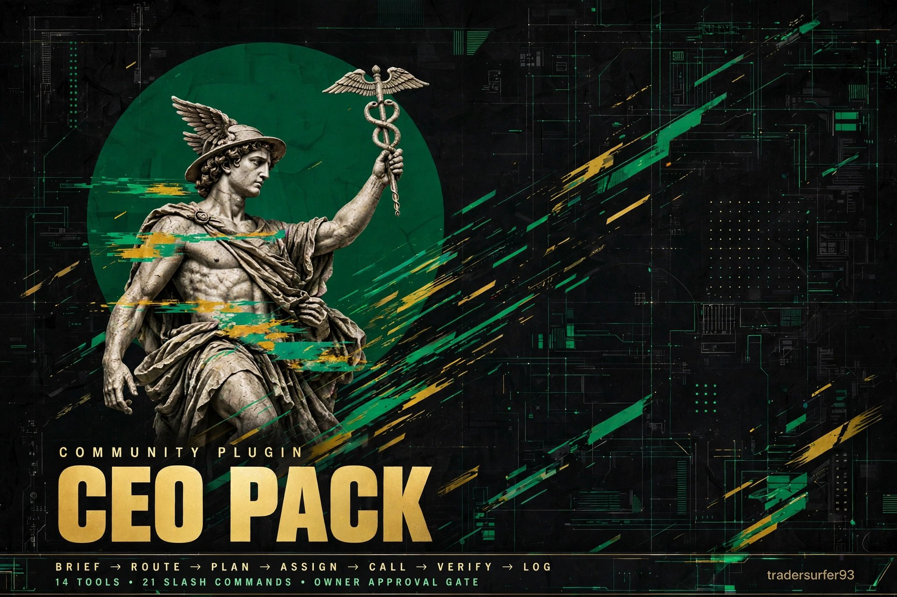

# CEO Pack



A CEO orchestration layer for Hermes — not a chat wrapper. Install it, name your CEO, tell it about your business on first run, and it briefs, routes, assigns, calls tools one at a time, verifies, and logs decisions — with Hermes as COO.

## Orchestration first

**Brief -> Route -> Plan -> Assign -> Call -> Verify -> Log**

- `ceo_orchestrate` — ordered plan for a goal, with seat, tool, arguments, and approval flag per step. 6 steps normally, 7 with the Q4 checklist for Q4 / year-end / tax goals.
- `ceo_tool_call` — validate a tool-call envelope before dispatch: exact tool name, JSON arguments, no credential keys or values (nested included), required fields, approval flag. Unknown tools and credential content are refused, and secret values are never echoed — only their path is named.
- `ceo_verify` — **new in v0.3.0.** Verify a tool result before reporting the step as done: status, expected fields, and next action (verify, retry once, stop and wait for the owner, or escalate). Unknown is never success, and a validated envelope is not a completed call. The `post_tool_call` hook also runs verification on every `ceo_*` result.
- `ceo_brief` — one-page brief: goal, decision needed, owners per workstream.
- `ceo_route` — route a task to the right seat by domain. Returns `COO (Hermes)` for Hermes; the orchestration layer canonicalizes that to `COO`.
- `ceo_assign` — one task, one owner, one ISO due date, one known seat. Missing fields, bad dates, and unknown seats are errors, not silent defaults. A past due date warns.
- `ceo_decision_log` — options, chosen option, reason, approval flag.
- `q4_closeout_checklist` — generic year-end checklist: books, tax items, annual filings, entity cleanup, annual reporting. Checklist only, not tax or legal advice.
- `ceo_closeout_checklist` — closeout for any quarter (Q1-Q4) or monthly, for bookkeeping and accounting.
- `ceo_daily_check` — daily or end-of-day check: shipped, earned, stuck, decisions.
- `ceo_performance_check` — employee performance review template (people = Type 1, owner approval).
- `ceo_status_check` — status of a briefing, assignment, task, log, or plan, from the item supplied. Never invents a status.
- `ceo_roster` — C-Suite roster view: seat, display name, bound profile, capabilities, gaps. The data for the install flow and the pinned CEO Dashboard.
- `ceo_choose_model` — pick a model by job and budget, with fallbacks and limits.

Tool-call rules: one tool at a time, check the JSON result before the next step, retry once with corrected arguments then escalate, never retry a write/send/payment blindly. Type 1 decisions (irreversible, priced, external, legal/financial, security, people, regulatory, reputation, outside authority) stop for the owner; Type 2 (reversible, low-cost, bounded) proceeds — step 4 is no longer blanket-gated. See `docs/ORCHESTRATION.md` and `CHANGELOG.md`.

Slash commands: `/ceo`, `/q4`, and `/orchestrate`, plus v0.4.0 shortcuts `/brief`, `/assign`, `/verify`, `/log`, `/decision`, `/route`, `/models`, `/weekly-pulse`, `/closeout`, `/q1`, `/q2`, `/q3`, `/monthly-closeout`, `/daily-checks`, `/eod-checks`, `/performance-checks`, `/status-check`, `/roster` (21 total).

## v0.4.0 — promote your agents to the C-Suite

- **Seat aliases:** rename a seat for display in install config, e.g. COO to Poseidon, CEO to Billy. Canonical seats never change, and logs show `Alias (Canonical)`. Bindings carry all three display fields — name, avatar, SOUL — display-only.
- **Head CEO:** `head_seat` config (default CEO) picks the seat that holds priorities and the decision log; `head_profile` optionally binds a Hermes profile to it. The human owner is still the final Type 1 gate.
- **Capability check:** each seat has a checklist in `orchestration.py`. `check_capabilities` lists what a bound profile is missing; `propose_capability_install` returns an owner-gated install plan. Declining leaves a name-only binding, flagged in plan and log.
- **Opt-in business-data reading:** `create_business_data_opt_in` makes an ephemeral, chat-scoped opt-in naming exact fields, a purpose, and an expiry. Every read is audited, revoke is instant, and a fresh opt-in is required for any future read. Fictional-data test only.
- **Hardened router and verifier:** see CHANGELOG.md. The Hermes live-test P0s are fixed and covered by 38 new tests in `tests/test_v040.py`.

## Model choice — free default, top-ranked options

Default is free, and the user can choose from the list in `models.py` / `docs/MODELS.md`:

| Choice | Use for |
|---|---|
| **Nemotron 3 Ultra free** (`nvidia/nemotron-3-ultra-550b-a55b:free`) | CEO default — 550B, 1M context, orchestration |
| GLM Flash free (Zen) | Fast daily CEO fallback |
| Nemotron 3.5 Lightning free / Ling 3.1 Flash `:free` | Fast, narrow worker jobs — never the CEO seat. The bare `inclusionai/ling-3.1-flash` ID is paid, not free — use the `:free` variant only. |
| `openrouter/free` | Random free fallback, tool-calling filtered |
| Claude Sonnet 5.5 / GPT-6.1 Sol | Paid value, everyday frontier |
| Claude Opus 5.5 | Paid flagship, high stakes only — override, not default |

Free caveat, up front: OpenRouter free is 20 req/min, 50 req/day until $10 of credits, then 1,000/day, and a CEO task uses many requests. Free lineups turn over fast — verify the live provider list before a demo. The plugin returns the choice and IDs; it does not call a model itself, so it stays stdlib-only and catalog-safe.

Seats: CEO, CFO, COO (Hermes), CTO, CMO, CLO, Chief of Staff, CRO.

## Approval gate

Nothing external, priced, or shipped without owner approval for that item. A decision log entry is not approval. Tools flag approval; the owner approves in chat.

## Install (local test)

```bash
cp -r ceo-pack ~/.hermes/plugins/ceo-pack
hermes plugins enable ceo-pack
hermes plugins doctor ~/.hermes/plugins/ceo-pack --ci
hermes plugins validate ~/.hermes/plugins/ceo-pack --install-deps
```

## Demo path (for the hackathon video)

1. Install by name.
2. Ask for a Q4 closeout brief.
3. Route and assign: CFO for books/tax prep, CLO for entity/filings, COO/Hermes for coordination.
4. Record the decision, show the approval gate stopping an external step until the owner approves.

## Privacy — what is NOT in this plugin

See `PRIVACY.md`. In short: no business data, no client data, no prices, no locations, no personal names, no credentials, no local portraits/animations, and no logs from any private machine. The user configures their own business on install. The `engines/` prompts use placeholders like `{{AGENT_NAME}}`, `{{BUSINESS_CONTEXT}}`, and `{{PRINCIPAL_NAME}}`.

## Sources

- Engines and docs adapted from `tradersurfer/ceo-agent` (public repo): task router, department prompts/behavior/contracts, architecture, behavior, memory layer, organization structure, and security docs — sanitized to placeholders in this build.
- Role sheets adapted from the local Dynasty Pack, with one correction: **Hermes is the COO**, not Maverick, and not a reserved messenger-only role in this pack.
- Hermes plugin structure follows the Hermes plugin guide: `plugin.yaml` + `register(ctx)` + bundled skills.

## License

MIT
